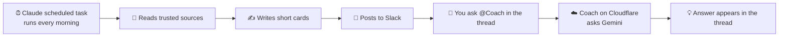

# My DIY Deepstash on Slack ☀️

I kept seeing Deepstash on Instagram and loved the idea: small ideas you actually finish reading. It was a bit pricey for me, so I made my own version in Slack.

It's not Deepstash. But every morning I get a few short, useful cards, and it costs me nothing extra.

## What it does

- **Every weekday morning**, short cards land in Slack channels:
  - `#sales-daily`: one sales or confidence tip
  - `#ai-tech-daily`: one AI or tech update that matters
  - `#gtm-builds`: an automation idea (Mon and Wed)
  - `#uae-careers`: UAE job market news and tips (Tue and Thu)
  - `#fun-friday`: something fun, plus a quiz on the week
  - `#java-daily`: a Java tip in the morning and an interview question in the evening (added for a friend)
- **React 🔥 or 💤** on a card, and future cards lean towards what you like.
- **Ask a follow-up**: reply in a card's thread with `@Coach your question` and a little bot answers in seconds.

## How it works

There are two parts:

1. **The daily cards.** A Claude scheduled task (included with Claude Pro) runs on a timer. It looks at the sources, writes the cards and posts them through Claude's Slack connector. The instructions it follows are in [`daily-cards/prompt.md`](daily-cards/prompt.md).
2. **Coach, the question bot.** A small Slack app that runs on Cloudflare Workers (free). When someone mentions it, it reads the card and asks Google's Gemini (free tier) for an answer. The code is in [`coach/worker.js`](coach/worker.js).

## What you need

- A free Slack workspace
- Claude Pro (for the scheduled task and Slack connector)
- A free Cloudflare account
- A free Gemini API key from Google AI Studio

## Set it up

### Part 1: Daily cards
1. Create your Slack channels.
2. In Claude, go to **Customize > Connectors** and connect Slack.
3. Copy [`daily-cards/prompt.md`](daily-cards/prompt.md), swap in your own channel IDs, and change the topics and sources to whatever you want to learn.
4. Ask Claude to turn it into a scheduled task that runs every weekday morning.

### Part 2: Coach
1. **Gemini key:** in Google AI Studio, create an API key.
2. **Slack app:** at api.slack.com/apps, choose *Create New App > From a manifest* and paste [`coach/slack-manifest.yaml`](coach/slack-manifest.yaml). Install it, then copy the **Bot token** and **Signing secret**.
3. **Cloudflare:** create a Worker (*Start with Hello World*), click *Edit code*, paste [`coach/worker.js`](coach/worker.js) and deploy.
4. In the Worker's **Settings > Variables and Secrets**, add three secrets: `SLACK_BOT_TOKEN`, `SLACK_SIGNING_SECRET`, `GEMINI_API_KEY`.
5. Back in the Slack app, turn on **Event Subscriptions**, paste your Worker's URL, and add the `app_mention` event.
6. In each channel, type `/invite @Coach`. Done.

## Good to know

- Ask Coach **inside the card's thread** so it knows which card you mean.
- Coach uses Gemini's fast, free model, so answers are short and simple.
- Free Slack only shows the last 90 days of messages. Save the cards you love.

Made for fun and daily learning. Feel free to copy it and make it yours. 🌱
